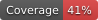

# Repository Coverage

[Full report](https://htmlpreview.github.io/?https://github.com/rubicon/ha-signal-lights-plus/blob/python-coverage-comment-action-data/htmlcov/index.html)

| Name                                                |    Stmts |     Miss |   Branch |   BrPart |   Cover |   Missing |
|---------------------------------------------------- | -------: | -------: | -------: | -------: | ------: | --------: |
| custom\_components/signal\_lights/\_\_init\_\_.py   |      108 |       80 |       32 |        0 |     20% |50, 55-62, 66-71, 75-78, 81-88, 91-93, 96-113, 119-129, 136-137, 143-167, 172-189 |
| custom\_components/signal\_lights/binary\_sensor.py |       24 |       24 |        2 |        0 |      0% |      7-55 |
| custom\_components/signal\_lights/config\_flow.py   |      247 |      178 |      104 |        5 |     25% |45-55, 64, 76-79, 83-85, 95-147, 175-184, 208-228, 267, 270-273, 320-336, 352-368, 384-414, 430-440, 455-469, 484-510, 513-\>530, 541-561, 583-618, 646-663, 689-704, 726-728 |
| custom\_components/signal\_lights/const.py          |       11 |        0 |        0 |        0 |    100% |           |
| custom\_components/signal\_lights/coordinator.py    |      257 |      157 |       80 |        3 |     35% |21-22, 45-68, 72-82, 91-92, 125-191, 199-202, 206, 212-214, 219-229, 276, 303-304, 320-321, 351-352, 358-381, 388-398, 404-430, 441-459, 516-522, 527-531, 545-\>547, 551-554, 558-559, 564, 568, 577-583, 588-594, 599 |
| custom\_components/signal\_lights/diagnostics.py    |       18 |        0 |        0 |        0 |    100% |           |
| custom\_components/signal\_lights/engine.py         |      220 |        8 |       82 |        6 |     95% |29, 40, 65, 72, 81, 90, 372-373 |
| custom\_components/signal\_lights/sensor.py         |       55 |       55 |        8 |        0 |      0% |     9-116 |
| custom\_components/signal\_lights/services.py       |      289 |      153 |      118 |       21 |     42% |33-35, 42, 44, 50-55, 217-248, 265-286, 298-312, 321-326, 332, 349, 357-361, 371-372, 384-408, 416-422, 439, 447-450, 456, 468-\>476, 470, 500-506, 520, 526-532, 537, 539, 541, 553, 555, 557, 576-579, 589-592, 597-598, 602, 614-628, 636-649, 664-672, 686-691 |
| custom\_components/signal\_lights/store.py          |      127 |       85 |       40 |        1 |     28% |53-56, 66-\>69, 87-130, 138, 146, 150-151, 155-162, 166-173, 181, 185-186, 191-199, 203-212, 216-223, 227-237, 241-242, 246-249, 257, 263-264 |
| custom\_components/signal\_lights/websocket.py      |       53 |       36 |       10 |        0 |     27% |18-19, 39-63, 82-84, 114-159 |
| **TOTAL**                                           | **1409** |  **776** |  **476** |   **36** | **42%** |           |

## Setup coverage badge

Below are examples of the badges you can use in your main branch `README` file.

### Direct image

This is the one to use if your repository is private or if you don't want to customize anything.

### [Shields.io](https://shields.io) Json Endpoint

Using this one will allow you to [customize](https://shields.io/endpoint) the look of your badge.
It won't work with private repositories. It won't be refreshed more than once per five minutes.

### [Shields.io](https://shields.io) Dynamic Badge

This one will always be the same color. It won't work for private repos. I'm not even sure why we included it.

## What is that?

This branch is part of the
[python-coverage-comment-action](https://github.com/marketplace/actions/python-coverage-comment)
GitHub Action. All the files in this branch are automatically generated and may be
overwritten at any moment.